# Pollar Studio

**Apps in minutes. Describe an app in plain words and get a live Stellar app with login, a wallet, stablecoin payments and bank cashouts, at its own link.**

> AI builds the whole app. Except the money part. Studio is the part that makes the money work.

| | |
|---|---|
| Live product | **https://app.pollar.studio** (open sign-up, email code or Google) |
| Marketplace of apps built with it | https://app.pollar.studio/studio/marketplace |
| Builder backend (generation, build, deploy) | https://github.com/pollar-xyz/pollar-app-builder-studio |
| Pollar docs and SDK | https://docs.pollar.xyz |
| Network | Stellar testnet for every generated app |
| HackMeridian path | **Scale** (Prototype -> Product): Pollar is in production, Studio is the step built at the event |

## Contents

- [The problem](#the-problem)
- [The solution](#the-solution)
- [How it works](#how-it-works)
- [Stellar integration](#stellar-integration)
- [Smart contracts with soroban-factory and Caatinga](#smart-contracts-with-soroban-factory-and-caatinga)
- [Stellar ecosystem tools we use](#stellar-ecosystem-tools-we-use)
- [Try it in 2 minutes](#try-it-in-2-minutes)
- [Architecture](#architecture)
- [Scale path: existing product, new work at the event](#scale-path-existing-product-new-work-at-the-event)
- [How we used AI](#how-we-used-ai)
- [Business model and market](#business-model-and-market)
- [What's next](#whats-next)
- [Judging criteria map](#judging-criteria-map)
- [Run it locally](#run-it-locally)
- [Technical reference](#technical-reference)

## The problem

AI coding tools can write the screens of an app in minutes. They stop at the money: wallets, keys and seed phrases, fees paid in XLM, trustlines, stablecoins, an anchor to reach a bank account, and somewhere to host it. That part still takes a developer weeks, and it is out of reach for everyone else.

The people who need it most are not developers:

- an empanada stand that wants a QR to get paid and cash out to the bank at night,
- a group of friends running a rotating savings circle,
- a teacher collecting a class fee,
- a cafe that wants a menu customers can pay from their phone.

They have a payments problem that Stellar already solves (5 second settlement in stablecoins, fees under a cent, anchors that reach local banks) and no way to use it.

## The solution

Pollar Studio turns one sentence into a live Stellar app. The end users of that app sign in with an email, never see a seed phrase, never buy XLM, pay in stablecoins and cash out to their bank.

| Without Studio | With Pollar Studio |
|---|---|
| First payment: weeks of integration | **Minutes** |
| Smart contracts: learn Rust, Soroban CLI, deploy by hand | **Written and deployed for you** |
| Bank cash out: integrate and certify an anchor | **3 countries in the composer: Bolivia (QR), Brazil (Pix), Argentina (bank transfer)** |
| XLM for fees, seed phrases for users | **None** |

Pollar is the engine and Studio is the door:

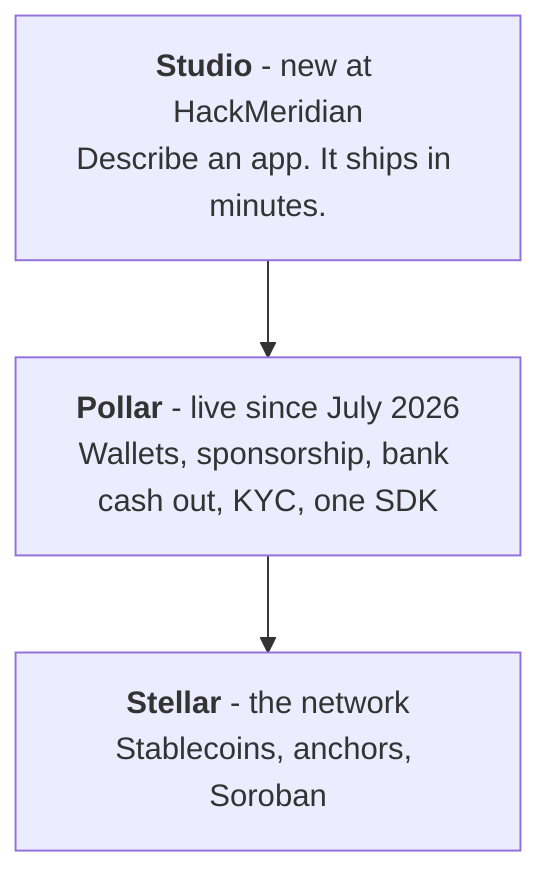

## How it works

Three steps for the maker: **prompt, AI builds it, publish.**

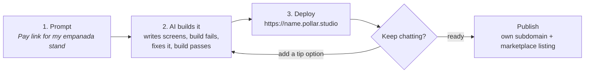

1. **You describe the app** ("a rotating savings circle for 10 friends with weekly contributions of 5 USDC") and pick the payment tokens and the cashout countries.
2. **An AI agent writes a real Next.js app** on top of the Pollar SDK (`@pollar/react`), with Pollar's agent skill and docs in its context. The build must pass before anything ships; a failed build is retried with the compiler output.
3. **Studio creates a Pollar application for it** in your own Pollar account: testnet network, publishable key, the payment assets with pinned issuers, and an app-scoped token. The app appears already configured in your Pollar dashboard.
4. **It deploys to its own URL** (`https://<name>.pollar.studio`). Build logs stream live in the chat and the preview opens next to it.
5. **You keep chatting to change it.** Every message is a new version with its own deploy. Questions are answered without rebuilding.
6. **You publish it** to a subdomain you choose and list it in the marketplace.

What one message turns into, end to end:

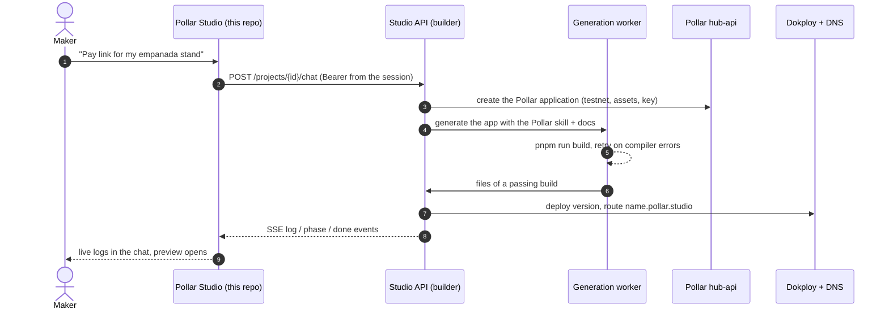

### What the generated app gives its users

Login, payments and bank cash out are built in. For the empanada stand: a home screen with the balance in stablecoins and today's sales, a "Pay with QR" screen for the customer, and "Cash out to bank" for the owner at the end of the day.

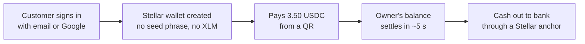

## Stellar integration

Stellar is not a plugin here: every generated app is a Stellar app, and the user-facing promises (no seed phrase, no gas, bank cash out) are Stellar features delivered through Pollar.

| What the end user gets | Stellar / ecosystem piece behind it |
|---|---|
| Sign in with email or Google, no seed phrase | Pollar wallets: a Stellar account created per user |
| No XLM needed for fees or trustlines | Pollar fee and reserve sponsorship (sponsored transactions and trustlines) |
| Pay and get paid in USDC / EURC | Stellar assets with pinned issuers |
| Cash out to a local bank account | Stellar anchors through Pollar ramps |
| Pay-per-use APIs | x402 payments on Stellar |
| Token swaps, passkeys | Pollar swaps, passkey sign-in |
| Smart contracts from a sentence ("hold the money until the order arrives") | Soroban contracts the builder writes in Rust and deploys; listed in the Contract tab with their stellar.expert link |
| App data that persists | A Postgres database per app (Neon), only for apps that need one |

Your app talks to one SDK and Pollar plugs it into the ecosystem:

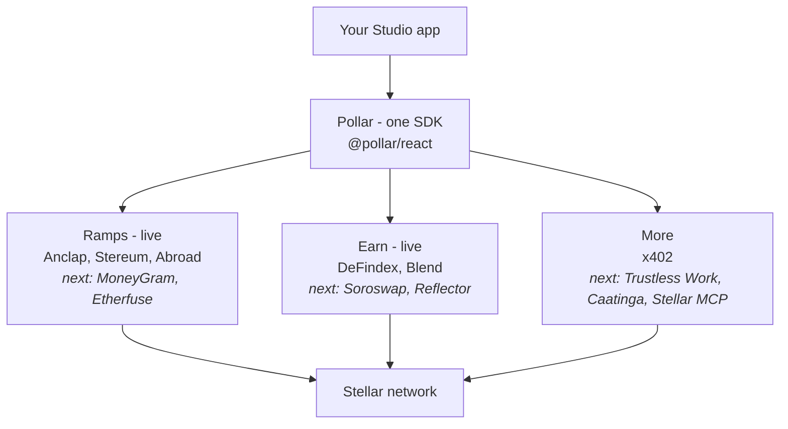

Every app built with Studio shares the same network and the same stablecoins:

- **Pay across apps.** Stablecoins earned in one app can be spent in any other.
- **Open by default.** Every payment settles on Stellar and is visible on stellar.expert.
- **No walled garden.** The apps are ordinary Next.js code on the Pollar SDK.

## Smart contracts with soroban-factory and Caatinga

A maker says "hold the money until the order arrives" and the app ships with a Soroban escrow contract. Nobody writes Rust, installs the Stellar CLI or holds a deployer key.

The builder writes the contract and **[soroban-factory](https://github.com/pollar-xyz/soroban-factory)**, our open-source contract build-and-deploy service (running at https://soroban-factory.pollar.dev), compiles and deploys it with **[Caatinga](https://www.npmjs.com/package/@caatinga/core)** (`@caatinga/core`, the `ctg` CLI):

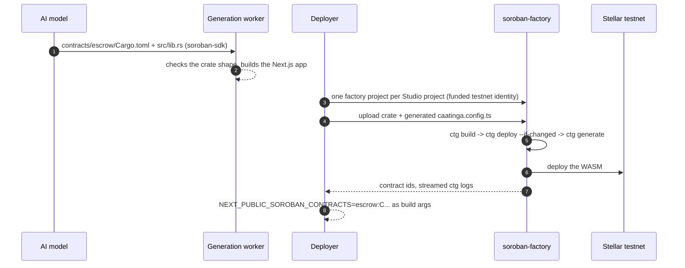

- **One factory project per Studio project.** soroban-factory funds a testnet identity for it; only its public `G...` address ever crosses the API, never a key.
- **Caatinga does the Soroban work.** The builder writes a `caatinga.config.ts` for the app's contracts and the factory runs `build -> deploy -> generate`. `ctg deploy --if-changed` keeps the same contract id when the WASM did not change.
- **Compile errors go back to the model.** A rustc error fails the message with its diagnostic, and the next message sees it and fixes the contract.
- **The app calls the contract through Pollar.** Generated apps get `app/lib/contract.ts` (`@stellar/stellar-sdk`): reads are simulated; writes are built from the user's wallet and signed and fee-sponsored by Pollar, so the user still needs no XLM.
- **Visible in Studio.** The Contract tab lists each contract, its status, its id with a stellar.expert link and the Rust source the AI wrote.

## Stellar ecosystem tools we use

| Tool | What it does in Studio |
|---|---|
| [Raven](https://raven.stellar.org) (Stellar MCP) | We used it while building to check our ideas and flows against Stellar; [AGENTS.md](AGENTS.md) points the coding agents working on this repo to it |
| [soroban-factory](https://github.com/pollar-xyz/soroban-factory) + [Caatinga](https://www.npmjs.com/package/@caatinga/core) | Compile and deploy the Soroban contracts the AI writes (see above) |
| [DeFindex](https://www.defindex.io) | Yield vaults behind Pollar Earn, available to generated apps through the SDK |
| [Blend](https://www.blend.capital) | Lending pools behind Pollar Earn, available through the SDK |
| [Trustless Work](https://www.trustlesswork.com) | Escrow reference in the model's Stellar knowledge base; SDK integration is next |
| Anclap, Stereum, Abroad | Stellar anchors and ramps behind bank cash out (Bolivia, Brazil, Argentina) |
| x402 | Pay-per-use APIs settled on Stellar |
| [Stellar Expert](https://stellar.expert) | Every payment and contract links to its public record |
| `@stellar/stellar-sdk`, `soroban-sdk` | Contract calls in the generated apps and the contracts themselves |

## Try it in 2 minutes

No invite, no API key, no wallet and no XLM needed.

1. Open **https://app.pollar.studio** and click **Sign in**.
2. Create an account with **an email (one-time code)** or **a Google account**.
3. On the home screen describe what you want, for example:
   *"A QR menu for my cafe. Customers scan the code, pick from six items and pay in USDC from their phone."*
4. Watch the chat: generation, build and deploy steps stream in real time, then the app opens in the **Preview** tab.
5. Open the generated app and sign in to it with email or Google, as a customer would. It creates your Stellar wallet. Everything runs on **Stellar testnet**.
6. Send another message to change it ("add a tip option"). **Deploys** shows the version history, **Built with** the Pollar and Stellar features the code really calls, and **Contract** any Soroban contract it deployed.
7. Press **Publish** to give it a public subdomain and list it in the marketplace.

## Architecture

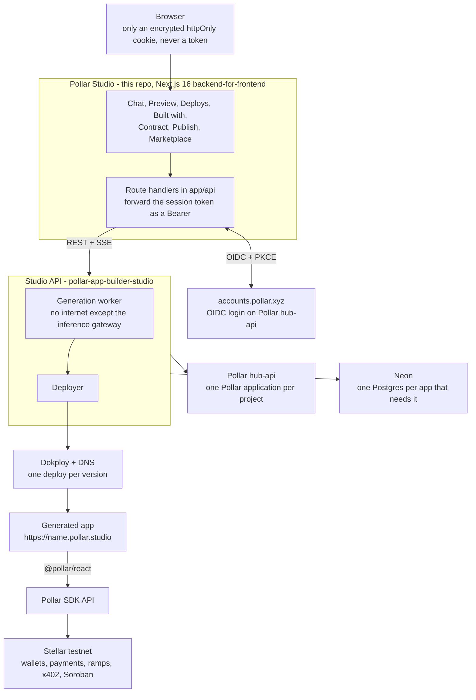

This repo is the Studio front end: login, chat with live job streaming, preview, deploy history, Built with, Contract, publishing and marketplace. Generation and deployment live in the builder repo.

Design choices worth knowing:

- **Tokens stay on the server.** The browser holds only `pollar_studio_session`, a JWE cookie. Route handlers attach the access token on the way out.
- **Real or nothing.** Real projects (`prj_...`) read everything from the Studio API. A failed publish or deploy is shown as an error, never as a success.
- **Every version is a deploy.** The Deploys tab reads real Dokploy history and logs; failed or expired versions are not offered as live links.
- **Isolated generation.** The worker that runs model output has no internet access except the inference gateway, and no cloud credentials.

## Scale path: existing product, new work at the event

We compete in the **Scale** path. Pollar is a working product: wallets, sponsorship, bank cash out, KYC and the SDK have been in production since July 2026. Studio is the step we took during HackMeridian (Oct 25 09:00 to Oct 26 12:00, Lisbon) to take Pollar from developers to people who do not code.

| Piece | Before the event | During the event |
|---|---|---|
| Studio front end (this repo) | Nothing: first commit on Oct 25, 2026 | All of it |
| Builder backend (`pollar-app-builder-studio`) | Started Oct 23: generation and Dokploy deployment foundation | A Pollar application per project, the Pollar design system and docs in the model's context, answering questions without rebuilding, per-app Neon databases, Soroban contracts through soroban-factory, publishing, credits, project deletion |
| Pollar platform (wallets, sponsorship, ramps, SDK) | Our production platform | Used as is; Studio is a new product on top of it |

Built in this repo during the event:

- Central Pollar login as an OIDC client (email code and Google), with tokens kept server-side.
- Chat with the builder, live generation logs over SSE, and reconnecting to running jobs after a reload.
- Live preview with full-screen mode and reload; Deploys tab with real Dokploy history and logs; Built with tab with the tools the code really uses; Contract tab with the app's Soroban contracts.
- Publishing to a custom subdomain and the public marketplace.
- Per-app Pollar credits, app deletion, and a confirmation before a chat message deletes app data.

**Production readiness:** Studio runs at https://app.pollar.studio on the same infrastructure as Pollar, with open sign-up, real deploys per version and real Pollar applications per project. Generated apps run on testnet until the per-app mainnet switch ships.

**Ecosystem impact:** every Studio app is a new Stellar app with its own users, sponsored wallets and stablecoin balances, built by someone who could not have built it before.

## How we used AI

AI writes the apps, so the harness is part of the product:

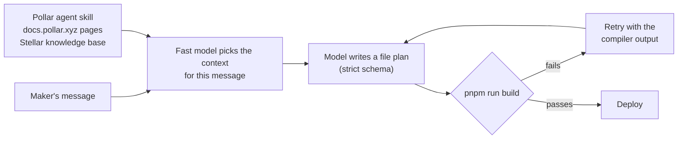

- **What the model reads:** Pollar's agent skill (`context/pollar-wallet-auth/` in the builder), the docs.pollar.xyz pages each app needs, and a Stellar ecosystem knowledge base, chosen per message by a fast model.
- **Guard rails:** the reply must follow a file-plan schema, the app must pass `pnpm run build`, packages come only from a pinned catalog, and the worker has no internet access and no cloud credentials.
- **Honest output:** the Built with tab shows the Pollar and Stellar tools the generated code really calls, with source evidence, not what the model claims.
- **For agents working on this repo:** [AGENTS.md](AGENTS.md) lists the conventions and the Pollar and Stellar references they use.

## Business model and market

**0% of your sales. You only pay credits.** Every app starts free and buys Pollar credits as it grows (100 credits = 1 USD); credits also pay the network fees the users never see.

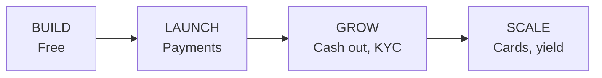

More services, more credits. The credits a Studio app spends are visible per app in Billing and Usage.

**Who uses it:** small merchants, informal savings groups, schools, cafes and event organizers in Latin America, where Pollar's ramps already reach the bank (Bolivia, Brazil, Argentina), and anyone who wants a payments app without hiring a developer. Each app brings new end users onto Stellar with stablecoin balances that move between every other Studio app.

**Why it is different:** general AI app builders stop where money starts. Studio generates the app and also creates its Pollar application, its sponsored wallets, its assets and its cashout, so what it ships can take real payments the same minute.

## What's next

- **Mainnet:** one switch per app, with the owner's Pollar credits paying for sponsorship.
- **Export to GitHub:** take the generated code anywhere.
- **More targets:** Telegram, WhatsApp and mobile (already in the composer as "soon").
- **More rails:** MoneyGram and Etherfuse for cash out; Soroswap, Reflector and Trustless Work through the SDK; Peru next in the country picker.
- **Templates** from the most used marketplace apps, so the next maker starts from one that works.

## Judging criteria map

Where each HackMeridian criterion is answered in this README (Scale path):

| Criterion | Weight | Where |
|---|---|---|
| Ecosystem Alignment | 20% | [Stellar integration](#stellar-integration), [Smart contracts with soroban-factory and Caatinga](#smart-contracts-with-soroban-factory-and-caatinga), [Stellar ecosystem tools we use](#stellar-ecosystem-tools-we-use) |
| User Value and Problem | 20% | [The problem](#the-problem), [The solution](#the-solution) |
| Technical Execution | 15% | [Try it in 2 minutes](#try-it-in-2-minutes) on the live product, [Architecture](#architecture), [Technical reference](#technical-reference), tests in `pnpm test` |
| Innovation | 15% | [How it works](#how-it-works), [How we used AI](#how-we-used-ai) |
| Hackathon Progress | 10% | [Scale path](#scale-path-existing-product-new-work-at-the-event): new work at the event, prior work declared |
| Market and Ecosystem Potential | 10% | [Business model and market](#business-model-and-market), [What's next](#whats-next) |
| Product Design and UX | 10% | Live at https://app.pollar.studio: one prompt box, live build logs, preview next to the chat |

## Run it locally

```bash
pnpm install
pnpm dev      # http://localhost:4719
pnpm caddy    # https://app.local.pollar.studio, needed for the OIDC redirect and the Secure cookie
pnpm test     # node --test over every *.test.mjs
pnpm lint
npx tsc --noEmit
```

Configuration is described in `.env.example`.

---

## Technical reference

### Authentication

Studio signs in through the central Pollar sign-in page as the `studio`
OpenID Connect confidential client of hub-api. It is a backend-for-frontend: the
browser holds only the `pollar_studio_session` cookie (httpOnly, Secure,
SameSite=Lax, a JWE encrypted with `STUDIO_SESSION_SECRET`) and never a token.

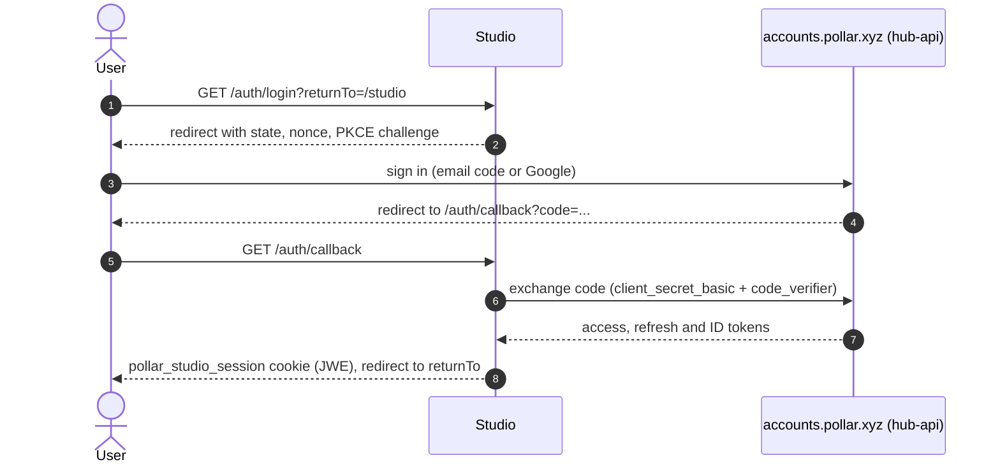

- `GET /auth/login?returnTo=/studio/...` creates `state`, `nonce` and the PKCE
  verifier, keeps them in the short-lived `pollar_studio_login` cookie and
  redirects to the issuer.
- `GET /auth/callback` checks `state`, exchanges the code with
  `client_secret_basic` + `code_verifier`, verifies the ID token and writes the
  session cookie (access, refresh and ID tokens, expiry, profile claims).
- `proxy.ts` sends signed-out visits under `/studio` to `/auth/login`, sends a
  signed-in visit to `/` on to `/studio`, and refreshes the access token a
  minute before it expires. Concurrent requests with the same refresh token
  share one refresh, because hub-api revokes the grant when a rotated refresh
  token is reused; that sharing is per process, so Studio runs one replica.
- `GET /api/auth/session` returns the profile (`id`, `mail`, `first_name`,
  `last_name`, `avatar`, `role`) for `useSession()`; never the tokens.
- `GET /auth/logout` revokes the refresh token, clears the cookie and ends the
  central session at the issuer, which returns to `/`.

Locally, open https://app.local.pollar.studio (`pnpm caddy`): the redirect URI
registered on hub-api and the Secure cookie both need that origin.

### Studio chat API

`POST /api/chat` forwards the session's access token as a Bearer to
`STUDIO_API_BASE_URL` (default: `https://api-studio.pollar.studio`). During local
development an optional server-side `STUDIO_DEV_TOKEN` in `.env.local` replaces
the session token. Never commit a token.

The first message creates a project without `displayName`; the backend names it
from the original prompt. Subsequent requests use the same project ID. Prompts
are sent unchanged to `POST /projects/{id}/chat`; conversation context is owned
by the backend.

The server consumes `GET /jobs/{id}/stream` using fetch with Authorization and
maps upstream `log`, `phase`, and `done` events to frontend SSE. Only URLs marked
`live` become the Preview iframe source. `building`, `failed`, and `expired` have
explicit preview states. Each successful deployment can replace the previous URL.
Stop/disconnect closes the stream; it does not cancel the job. The stream has a
ten-minute timeout.

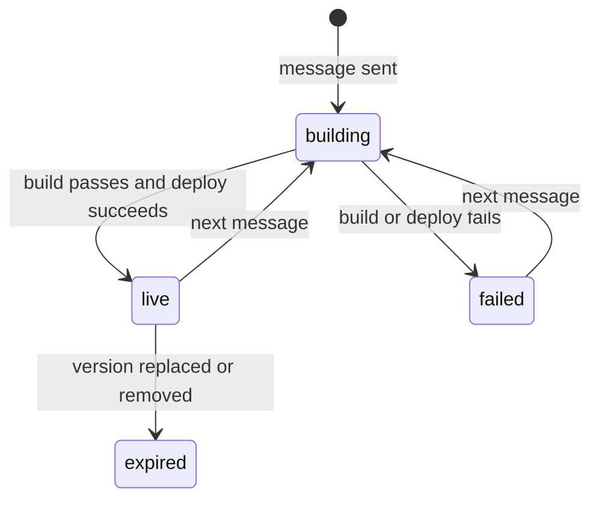

`GET /api/chat` lists owned projects. `GET /api/chat?appId=prj_...` retrieves a
project and its persisted conversation; `?jobId=job_...` reads a job. On reload,
active jobs reconnect with `resumeJobId` instead of creating another generation.
Conversations are held in memory while navigating and recovered from the backend
after a reload. Chat messages and logs are not persisted in browser storage.

### Deployment history

The Deploys tab reads real Dokploy records through `GET /api/deployments?appId=prj_...`.
The server forwards the session's Bearer to `GET /api/v1/projects/{projectId}/jobs`
and reads the project's stable URL. Expanded rows request persistent logs through
`GET /api/deployments?appId=prj_...&jobId=job_...`; the server verifies the job is
in that project's deployment history before reading `/api/v1/jobs/{jobId}/logs`.
All responses bypass caching. No Dokploy administrator credential is needed.

History refreshes every five seconds while visible, including after a deployment
finishes so new chat deployments appear. Open active logs refresh every three
seconds and once more on completion. Requests stop on navigation; background tabs
resume when visible. Failed or expired version URLs are not offered as live links.
Demo project IDs show an explanatory empty state instead of fabricated history.

The Studio API has no standalone redeploy or GitHub export endpoint. Send a chat
message to generate and deploy a new version.

### Contract

For projects created in Studio, the Contract tab reads `GET /api/contracts?appId=prj_...`, which
forwards the session's Bearer to `/api/v1/projects/{projectId}/contracts`. It lists the app's Soroban
contracts as the builder deployed them through soroban-factory: name, status (`pending` until a
deploy succeeds), contract id with a stellar.expert link, when it went live, and the Rust source the
AI wrote. An app without contracts shows how to ask for one. Demo apps keep the illustrated mock view.
The tab refreshes every ten seconds while visible. When a generation deploys contracts, the chat answer
ends with their ids (the `done` event's `contracts`).

### Built with

`GET /api/built-with?appId=prj_...` forwards the session's Bearer to the Studio
project, `/api/v1/projects/{projectId}/summary`, and `/api/v1/tools` endpoints.
The tab displays the summary's tool usage and source evidence, resolving names
through the tool catalog. Detailed usage takes precedence over AI declarations;
additional declared tools are labeled Reported, and project settings without
usage evidence are labeled Configured. Catalog defaults never become project
integrations.

An owned project without a generated summary shows its available settings and
an empty state. Missing or inaccessible projects remain errors. The tab refreshes
every ten seconds while visible and supports manual refresh and retry.

### Publishing generated apps

The Preview Publish button opens the real-project publishing modal. `/api/marketplace` forwards the authenticated user's token and project revision to `PUT/DELETE /api/v1/projects/{id}/publication`. The backend configures the chosen HTTPS subdomain of `pollar.studio`, verifies availability, and then lists the app. The marketplace reads public listings on the server and opens their public URLs.

Set `STUDIO_API_BASE_URL` to the builder backend. For local development this can be `http://127.0.0.1:3001`; the default points at the team's remote API. Publishing requires an already deployed app, Dokploy credentials and DNS routing on that backend. Missing configuration or failed readiness is shown as an error, never as a successful publication.

### Tests

```bash
pnpm test
```

Runs `node --experimental-transform-types --test` over every `*.test.mjs`, importing the TypeScript sources directly: auth, chat streaming, generation steps, job streams, deployments and Built with routes.
